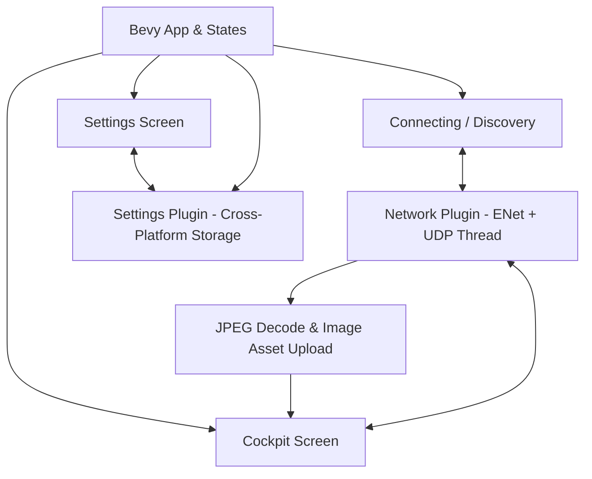

# Bevy Client Rewrite Plan (`client-rust`)

## Goal
Rewrite the existing LÖVE2D client (`falcon-bms-control/client`) in Rust using **Bevy 0.20.1** and **`enet`** (`kungfoo/enet-rs`, matching `falcon-bms-control-server`).

- **Initial targets**: Linux and Windows.
- **Future targets**: Android and iOS (architecture, dependencies, input, and settings storage must stay mobile-compatible from day one).
- **Layouts**: Start with the 4 built-in layouts (`default-landscape`, `cockpit-like`, `consolidated`, `one-device-per-screen`) represented as data-driven structs so loading layouts from the server can be added cleanly later.

---

## High-Level Architecture



---

## Crate & Module Structure

`falcon-bms-control/client-rust` will use a **library + binary** layout from the start (`lib.rs` + `main.rs`) so Android/iOS `#[bevy_main]` entry points can be added later without restructuring.

```text
client-rust/
├── Cargo.toml
├── docs/
│   └── plans/
│       └── bevy-client-rewrite.md
├── assets/
│   ├── fonts/                  # Reused B612Mono-Regular.ttf
│   ├── icons/                  # Reused close.png, settings.png
│   └── sounds/                 # Reused button click sounds
└── src/
    ├── main.rs                 # Desktop entry point -> calls client_rust::run()
    ├── lib.rs                  # Bevy App setup (mobile-ready)
    ├── protocol.rs             # ProtocolMessage & Command (duplicated from server, rmp-serde)
    ├── settings/
    │   ├── mod.rs              # Settings Resource, defaults, change handling, fullscreen sync
    │   └── storage.rs          # Cross-platform settings persistence (Linux/Win/Android/iOS)
    ├── network/
    │   ├── mod.rs              # NetworkPlugin, Bevy Resources & Events
    │   ├── worker.rs           # Background thread: UDP discovery (9020) + ENet client (9022)
    │   └── textures.rs         # Off-thread JPEG decode -> in-place Bevy Assets<Image> updates
    ├── layouts/
    │   ├── mod.rs              # Serializable Layout/Screen/Split/Component types & registry
    │   └── builtin.rs          # The 4 built-in layouts (ready to accept server-sent layouts later)
    └── ui/
        ├── mod.rs              # AppState (Connecting, Cockpit, Settings) & shared theme/colors
        ├── connecting.rs       # Discovery/Connecting screen + Settings button
        ├── cockpit.rs          # Layout renderer, screen switcher, Footer, stream start/stop lifecycle
        ├── settings.rs         # Settings screen + built-in IP numpad
        └── components/
            ├── mfd.rs          # 20 OSBs + live MFD ImageNode
            ├── icp.rs          # ICP (portrait & landscape) buttons + WPT/DED rockers
            ├── ded.rs          # Live DED ImageNode + bezel
            └── rwr.rs          # Live RWR ImageNode + circular clip/reticle overlay
```

---

## Core Dependencies (Mobile-Safe)
- `bevy = "0.20.1"`
- `enet = { version = "0.4.0", git = "https://github.com/kungfoo/enet-rs.git" }`
- `serde = { version = "1", features = ["derive"] }`
- `rmp-serde = "1.3"` (protocol wire format)
- `toml = "0.8"` (human-readable settings file)
- `crossbeam-channel = "0.5"` (communication between network/decode threads and Bevy)
- `image = { version = "0.25", default-features = false, features = ["jpeg"] }` (pure-Rust JPEG decoding—avoids cross-compiling native `libturbojpeg` for Android/iOS)
- `directories` gated to desktop targets (`#[cfg(any(target_os = "linux", target_os = "windows", target_os = "macos"))]`)

---

## Key Design Decisions

### 1. Cross-Platform Settings Storage (`src/settings/storage.rs`)
Persist `settings.toml` behind a single `load_settings()` / `save_settings()` interface:
- **Linux / Windows / macOS**: `directories::ProjectDirs::from("com", "falcon-bms-control", "client")` -> `config_dir()/settings.toml`.
- **Android**: `#[cfg(target_os = "android")]` using `bevy::window::ANDROID_APP` -> `internal_data_path()/settings.toml`.
- **iOS**: `#[cfg(target_os = "ios")]` using `$HOME/Library/Application Support/falcon-bms-control/settings.toml`.
- Defaults match the existing client (`refresh_rate = 30`, `quality = 70`, `vibrate = false`, `ip = None`, `layout = "default-landscape"`, `fullscreen = true`).
- `fullscreen` is applied at startup and immediately on toggle (desktop platforms).

### 2. Networking & Texture Streaming (`src/network/`)
- **Dedicated ENet/UDP Worker Thread**: `enet::Host` is not `Send`/`Sync`, so it lives on a dedicated thread.
  - Drains **all** outgoing commands via `try_recv()` and drains **all** incoming ENet events via `while let Ok(Some(event)) = host.service(0)` each iteration (~2ms sleep) to avoid queue backlog or starvation.
  - Handles UDP broadcast discovery (`255.255.255.255:9020`, `Hello`/`Ack`) when no static IP is set.
  - Cleanly disconnects old peers before reconnecting when settings change.
- **Texture Decode Pipeline**:
  - Channels map to devices: `1 = LeftMfd`, `2 = RightMfd`, `3 = Ded`, `4 = Rwr`.
  - JPEG frames are decoded off the main thread; if a newer frame arrives for the same channel before the previous one is consumed, the older frame is dropped so latency never accumulates.
  - Decoded RGBA buffers update persistent `Handle<Image>` assets in-place on the main thread.

### 3. Input & UI (`src/ui/`)
- **Touch + Mouse Unified Input**: Use Bevy's UI/pointer interaction events so mouse clicks and touch taps behave identically. Track pressed state per button and always emit `*ButtonReleased` even if the pointer leaves the button before release so BMS keys never get stuck.
- **Built-in IP Numpad**: In Settings, editing the Server IP opens an on-screen `0-9`, `.`, `Backspace`, `Clear`, `OK` numpad so it works reliably on Linux, Windows, Android, and iOS without mobile IME issues.
- **Stream Lifecycle**: Entering a cockpit screen sends `StreamedTextureRequest { Start }` for the streamed components on that screen; leaving sends `Stop`.
- **Future Server Layouts**: Layout structs derive `Serialize`/`Deserialize` from the start, making it straightforward to add a protocol message for fetching layouts from the server later.

---

## Phased Implementation Roadmap & Progress

### Completed
1. **Phase 1 — Foundation** ✅
   - Scaffolded `falcon-bms-control/client-rust` (`Cargo.toml`, `lib.rs`, `main.rs`) with trimmed Bevy `0.20.1` UI/audio/PNG/text features and an opt-in `dev` feature (`bevy/dynamic_linking`) for fast dev builds (`cargo dev` / `cargo run --features dev`), while `cargo build --release` is statically linked by default.
   - Copied reusable assets (`fonts/`, `icons/`, `sounds/`) from `client/`.
   - Implemented `protocol.rs` (`ProtocolMessage`, `Command`, `TextureChannel`) with msgpack roundtrip tests.
   - Implemented `settings/` with cross-platform `settings.toml` storage (Linux, Windows, macOS, Android, iOS), IPv4 validation, and immediate fullscreen sync.
2. **Phase 2 — Networking & Streaming** ✅
   - Implemented `network/worker.rs` (UDP broadcast discovery on port `9020` + ENet client on port `9022`, draining all commands and ENet events every tick).
   - Implemented `network/textures.rs` (off-thread pure-Rust JPEG decoding with latest-frame-only mailbox and in-place `Assets<Image>` updates).
   - Implemented `ui/connecting.rs` (`Connecting` screen + live discovery/connection status + Settings button).
   - Verified live UDP discovery, ENet connection, and MFD texture streaming against `falcon-bms-control/lua-server` on Linux.
3. **Phase 3 — Layouts & Cockpit Components** ✅
   - Implemented serializable `layouts/` registry with all 4 built-in layouts (`default-landscape`, `cockpit-like`, `consolidated`, `one-device`).
   - Implemented `Mfd` (3×3 CSS Grid with 20 identical square OSBs), `Ded`, `Rwr` (circular clip + reticle overlay), `Icp` (portrait & landscape, uniform rotated triangle icons on WPT rocker and 4-way DED dobber), screen switcher footer, button press/release audio, stuck-key-safe pointer observers, and per-screen `Start`/`Stop` stream lifecycle.
   - Implemented responsive `FitBox` / `FitScale` layout fitting (`PositionType::Absolute` inside center-aligned slots) so all components resize immediately in both windowed and fullscreen modes.
4. **Phase 4 — Settings Screen & Polish** ✅
   - Implemented `ui/settings.rs` (refresh rate `15/30/60`, compression quality `50–90`, vibration toggle, fullscreen toggle, layout picker with descriptions, and built-in touch/mouse IP Numpad modal).
   - 27 unit tests passing (`cargo test`).

---

### Remaining Work
5. **Phase 5 — Cross-Platform Builds & Live Server Verification**
   - [ ] Verify Windows cross-compilation (`cargo build --target=x86_64-pc-windows-gnu --no-default-features`) and test against `falcon-bms-control-server` on Windows (including live MFD/DED/RWR streaming and OSB/ICP input).
   - [ ] Decide on asset bundling for desktop release builds (ship `assets/` next to binary vs. embed via `bevy_embedded_assets`).
   - [ ] Add `#[bevy_main]` entry point in `lib.rs` and `crate-type = ["cdylib", "rlib", "staticlib"]` in `Cargo.toml` for mobile targets.
   - [ ] Android packaging: Gradle / `cargo-ndk` wrapper, `AndroidManifest.xml` permissions (`INTERNET`, `ACCESS_WIFI_STATE`, `CHANGE_WIFI_MULTICAST_STATE`), verify `enet-sys` NDK cross-compile, and test settings persistence + touch input.
   - [ ] iOS packaging: Xcode wrapper, `NSLocalNetworkUsageDescription` in `Info.plist`, verify `enet-sys` iOS SDK build, and test settings persistence + touch input.
   - [ ] Mobile UX polish: safe-area insets (notches/home bars) and optional platform haptic feedback when `settings.vibrate` is enabled.
6. **Future Enhancements**
   - [ ] Server-provided layouts: add protocol message(s) so the client can fetch/sync custom `LayoutDefinition`s from `falcon-bms-control-server` via `LayoutRegistry::upsert()`.
   - [ ] Revisit server unreliable packet mode + `last_hash` deduplication if static MFD frames ever drop over lossy Wi-Fi.
